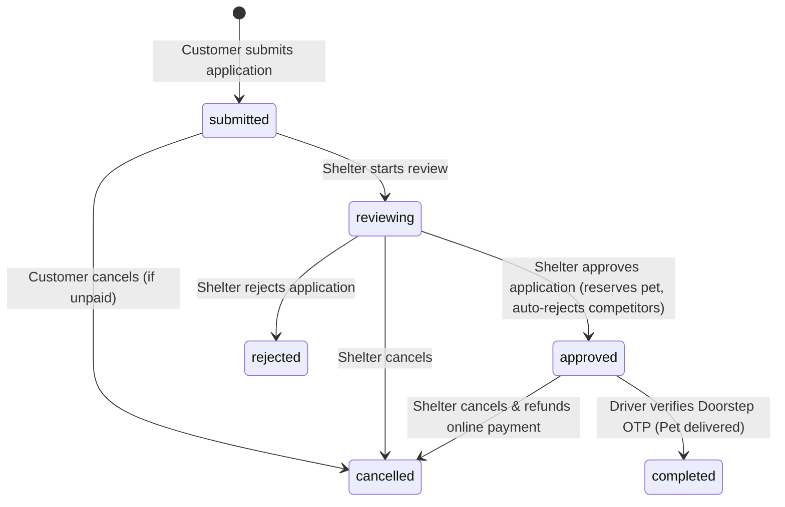
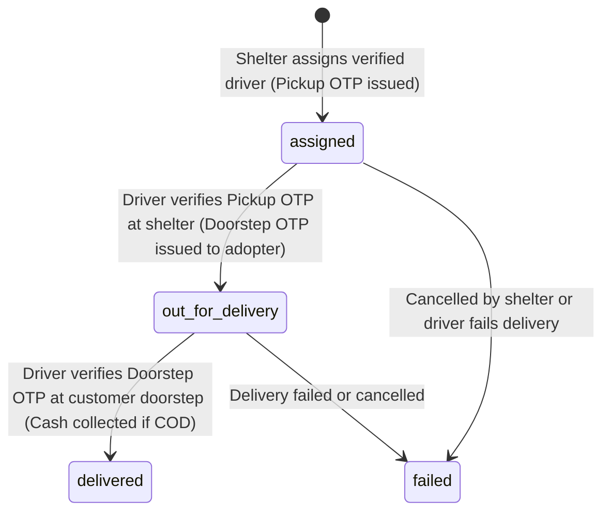

# PetAdoptGem — Pet Adoption & Logistics Backend Platform

[](https://github.com/Murali7907/petadoptgem/actions/workflows/ci.yml)
[](LICENSE)
[](https://www.python.org/)
[](https://www.djangoproject.com/)
[](https://www.django-rest-framework.org/)
[](https://www.postgresql.org/)

A production-hardened, modular Django REST Framework backend for pet adoption management, veterinary KYC records, and coordinated doorstep logistics. The platform safely bridges animal shelters, prospective adopters, and delivery drivers with tiered location privacy, atomic OTP-verified handovers, Cash-on-Delivery (COD) reconciliation, online Razorpay payments with webhooks, and asynchronous timing-safe authentication.

---

## Technical Stack & Pinned Versions

All dependency versions are pinned in [`backend/requirements.lock.txt`](backend/requirements.lock.txt) and verified in Continuous Integration:

| Component | Technology | Exact Version | Verification Reference |
|---|---|---|---|
| **Runtime Language** | Python | `3.12+` | Verified in `.github/workflows/ci.yml` (`3.12`) |
| **Web Framework** | Django | `6.1.2` | `Django==6.1.2` |
| **API Framework** | Django REST Framework | `3.18.3` | `djangorestframework==3.18.3` |
| **Authentication** | SimpleJWT | `5.5.1` | `djangorestframework_simplejwt==5.5.1` |
| **Database Engine** | PostgreSQL | `16` (tested) / `14+` compatible | Tested via `postgres:16` in CI services |
| **Database Adapter** | Psycopg 3 | `3.3.6` | `psycopg==3.3.6` / `psycopg-binary==3.3.6` |
| **API Schema & Docs** | drf-spectacular | `0.30.0` | `drf-spectacular==0.30.0` (OpenAPI 3.0) |
| **Payment Gateway** | Razorpay Python SDK | `2.0.1` | `razorpay==2.0.1` |
| **Image & Media** | Pillow / Cloudinary | `12.3.0` / `1.46.3` | `pillow==12.3.0`, `cloudinary==1.46.3` |
| **Caching & Rate Limits** | Redis / LocMem | `8.1.0` | `redis==8.1.0` |
| **WSGI Server** | Gunicorn | `26.2.0` | `gunicorn==26.2.0` |
| **Static File Serving** | WhiteNoise | `6.12.0` | `whitenoise==6.12.0` |

*Note: The platform utilizes standard PostgreSQL. Spatial distance and proximity queries are computed entirely using spherical Haversine trigonometric expressions (`6371 * acos(...)`) in pure SQL without requiring PostGIS extensions, GDAL, or GEOS system libraries.*

---

## Role-Based Access Control

The platform enforces four explicit user roles (`RoleEnum` in [`backend/apps/accounts/models.py`](backend/apps/accounts/models.py)):

| Role | Target Users | Core Capabilities & Permissions |
|---|---|---|
| `customer` | Prospective Adopters | Public discovery, bookmarking (`/favorites/`), adoption application submission, online Razorpay checkout, live delivery GPS tracking, doorstep OTP receipt, and dual reviews. |
| `shelter` | Animal Shelters & Rescue Staff | Pet CRUD, photo & medical record PDF uploads, application review/approval/rejection, driver assignment, pickup OTP verification, cancellation & refunds, and COD cash reconciliation. Requires administrator vetting (`is_verified=True`) for mutation operations. |
| `delivery` | Delivery Fleet Drivers | Active task inspection, live GPS location updates (`/ping/`), physical pickup OTP verification, Cash-on-Delivery collection, and doorstep OTP verification. |
| `admin` | Platform Administrators | Full platform analytics dashboard, shelter verification status toggling, driver account provisioning, and system-wide delivery/refund overrides. |

---

## Real Lifecycle State Machines

### 1. Adoption Application Lifecycle
Defined in [`backend/apps/adoptions/models.py`](backend/apps/adoptions/models.py) (`ApplicationStatus`):



- `submitted`: Application submitted by adopter with housing details and identity proof.
- `reviewing`: Shelter actively reviewing applicant details and home environment.
- `approved`: Shelter approved application; pet transitions from `available` to `pending`; competing applications are automatically rejected.
- `rejected`: Shelter rejected application; competing applications remain unaffected.
- `cancelled`: Application cancelled by customer or cancelled via shelter refund. Pet returns to `available`.
- `completed`: Delivery confirmed at customer doorstep; pet permanently marked `adopted`.

### 2. Pet Delivery Logistics Lifecycle
Defined in [`backend/apps/logistics/models.py`](backend/apps/logistics/models.py) (`DeliveryStatus`):



- `assigned`: Delivery task created; driver locked to assignment; 6-digit pickup OTP issued to shelter.
- `out_for_delivery`: Driver verifies pickup OTP at shelter; delivery payment verified; pet in transit; doorstep OTP issued to customer.
- `delivered`: Driver verifies customer doorstep OTP (and collects physical cash if COD); delivery completed; pet adopted.
- `failed`: Delivery aborted or failed; driver is immediately released (`is_available=True`); pet remains reserved or released depending on cancellation reason.

---

## Key Features & Security Architecture

1. **Full Adoption Lifecycle & Workflow Automation**
   - Public pet listings with breed, age, gender, size, and location filtering.
   - Competing application handling: approving one application atomically marks competing applications `rejected`.
2. **Tiered Location Privacy & Proximity**
   - Public visitors only see shelter city and spherical Haversine distance (`distance_km`).
   - High-precision GPS coordinates, pickup street addresses, and shelter phone numbers remain masked (`null`) until an adopter's application is approved.
3. **Dual OTP Cryptographic Handover Protocol**
   - 6-digit one-time passwords stored exclusively as salted HMAC-SHA256 hashes (`pickup_otp_hash`, `doorstep_otp_hash`).
   - Strict 3-attempt brute-force limit (`OTP_MAX_ATTEMPTS`) with database row locks (`select_for_update`) to prevent race conditions.
   - Administrative OTP reissuance endpoint (`POST /api/v1/shelter/deliveries/<id>/reissue-otp/`) for expired or locked-out deliveries.
4. **Cash-on-Delivery (COD) & Shelter Cash Reconciliation**
   - Dedicated driver cash collection endpoint (`POST /api/v1/delivery/tasks/<id>/collect-cash/`).
   - Two-phase shelter settlement (`POST /api/v1/shelter/deliveries/<id>/reconcile-cash/`) with idempotency guards.
5. **Online Payments with Idempotent Webhook Processing**
   - Razorpay order creation and HMAC-SHA256 signature verification.
   - Webhook listener handling `payment.captured`, `refund.processed`, and `refund.failed` with payload integrity validation.
6. **Gateway Refund Synchronization & Idempotency**
   - Full refund dispatch with `X-Refund-Idempotency` headers.
   - Status mapping: `processed` stamps completion and emails adopter; `pending` sets `processing` awaiting webhook; `failed` stores failure reason.
   - Automated offline retry scheduler (`python manage.py retry_pending_refunds`).
7. **Timing-Safe Password Reset**
   - `POST /api/v1/auth/password-reset/` responds uniformly in ~5–15 ms for both registered and unregistered email addresses.
   - Reset emails are dispatched asynchronously inside `transaction.on_commit` using a lightweight daemon thread (`AUTH_PASSWORD_RESET_ASYNC_EMAIL = True`), completely eliminating timing-based account enumeration attacks.
8. **Email Verification & Account Hardening**
   - Cryptographically signed URL tokens (`TimestampSigner`) for email confirmation.
   - Logistics gate: deliveries cannot be assigned to adopters with unverified emails (`adopter_email_unverified`).
   - Profile email updates require `current_password` and alert the previous email address.
9. **In-App Notifications & Dual Reviews**
   - Filterable in-app notification center for application updates, payment confirmations, and driver arrivals.
   - Mutual post-delivery reviews with 1–5 star ratings and feedback for shelters and drivers.
10. **Platform Administration Dashboard**
    - Aggregated operational KPIs, shelter vetting verification actions, and driver account creation.

---

## Local Setup & Development Guide

### Prerequisites
- **Python**: Version 3.12 or newer.
- **PostgreSQL**: Version 14 or newer (PostgreSQL 16 recommended).
- **Git**

---

### Setup on Windows (PowerShell)

```powershell
# 1. Clone repository and navigate to root
git clone https://github.com/Murali7907/petadoptgem.git
cd petadoptgem

# 2. Create and activate virtual environment
python -m venv backend\.venv
.\backend\.venv\Scripts\Activate.ps1

# 3. Upgrade pip and install pinned dependencies
python -m pip install --upgrade pip
pip install -r backend\requirements.lock.txt

# 4. Configure environment variables
Copy-Item backend\.env.example backend\.env
# Open backend/.env in your editor and configure your DB_PASSWORD and local settings

# 5. Apply database schema migrations
python backend\manage.py migrate

# 6. Seed mock development dataset
python backend\manage.py seed_platform

# 7. Start local development server
python backend\manage.py runserver
```

---

### Setup on Linux / macOS (bash / zsh)

```bash
# 1. Clone repository and navigate to root
git clone https://github.com/Murali7907/petadoptgem.git
cd petadoptgem

# 2. Create and activate virtual environment
python3 -m venv backend/.venv
source backend/.venv/bin/activate

# 3. Upgrade pip and install pinned dependencies
python -m pip install --upgrade pip
pip install -r backend/requirements.lock.txt

# 4. Configure environment variables
cp backend/.env.example backend/.env
# Edit backend/.env with your PostgreSQL credentials

# 5. Apply database schema migrations
python backend/manage.py migrate

# 6. Seed mock development dataset
python backend/manage.py seed_platform

# 7. Start local development server
python backend/manage.py runserver
```

---

### Running Automated Tests

Run the full automated test suite (340+ tests across all applications):

```bash
python backend/manage.py test --noinput
```

To run per-app test suites:
```bash
python backend/manage.py test apps.accounts --noinput
python backend/manage.py test apps.pets --noinput
python backend/manage.py test apps.adoptions --noinput
python backend/manage.py test apps.logistics --noinput
python backend/manage.py test apps.reviews --noinput
```

To run static security and deployment verification checks:
```bash
python backend/manage.py check
python backend/manage.py makemigrations --check --dry-run
python backend/manage.py migrate --plan
python -X utf8 backend/manage.py spectacular --validate --fail-on-warn
```

---

## Seed Platform Command Notice

> [!CAUTION]
> The `seed_platform` management command ([`backend/apps/accounts/management/commands/seed_platform.py`](backend/apps/accounts/management/commands/seed_platform.py)) **strictly refuses to execute** when `DEBUG=False`.
>
> Attempting to run `python manage.py seed_platform` in production raises a `CommandError` and aborts.
> The seeded demo credentials (e.g. `customer_pass123`, `shelter_pass123`) are hardcoded exclusively for local development and testing, and must never be used in live environments.

---

## Production Environment Variables

All platform configuration is managed via environment variables. The following table details every variable from [`backend/.env.example`](backend/.env.example) and its production requirements:

| Variable | Requirement in Prod | Default (if unset) | Description |
|---|---|---|---|
| `SECRET_KEY` | **Required** | *None* | Cryptographic signing key (must be 50+ chars, 20+ unique chars, cannot start with `django-insecure-`). |
| `DEBUG` | **Required** | `False` | Must be explicitly set to `False` in production. |
| `ALLOWED_HOSTS` | **Required** | `localhost` | Comma-separated domain names (e.g. `petadopt.example.com`). Cannot be `*` or empty when `DEBUG=False`. |
| `DB_NAME` | **Required** | `pet_adoption` | Production PostgreSQL database name. |
| `DB_USER` | **Required** | `postgres` | Production PostgreSQL database username. |
| `DB_PASSWORD` | **Required** | *None* | Production PostgreSQL database password. |
| `DB_HOST` | **Required** | `127.0.0.1` | Database server hostname or IP. |
| `DB_PORT` | Optional | `5432` | Database server port. |
| `RAZORPAY_KEY_ID` | **Required** | *None* | Live Razorpay key ID. Cannot contain `mock`. |
| `RAZORPAY_KEY_SECRET` | **Required** | *None* | Live Razorpay key secret. Cannot contain `mock`. |
| `RAZORPAY_WEBHOOK_SECRET` | **Required** | *None* | Razorpay webhook secret for HMAC signature verification. |
| `REFUND_RETRY_AFTER_MINUTES` | Optional | `10` | Age threshold in minutes before automated refund retry. |
| `EMAIL_BACKEND` | **Required** | SMTP | `django.core.mail.backends.smtp.EmailBackend` in production. |
| `EMAIL_HOST` | **Required** | *None* | Outgoing SMTP mail server hostname. |
| `EMAIL_PORT` | Optional | `587` | Outgoing SMTP port (587 for TLS, 465 for SSL). |
| `EMAIL_HOST_USER` | **Required** | *None* | SMTP authentication username. |
| `EMAIL_HOST_PASSWORD` | **Required** | *None* | SMTP authentication password / API token. |
| `EMAIL_USE_TLS` | Optional | `True` | Enable STARTTLS encryption. |
| `EMAIL_USE_SSL` | Optional | `False` | Enable SSL encryption. |
| `EMAIL_TIMEOUT` | Optional | `10` | SMTP network connection timeout in seconds. |
| `DEFAULT_FROM_EMAIL` | **Required** | *None* | Sender address for transactional emails. Cannot contain `mock`. |
| `USE_CLOUDINARY` | Optional | `False` | Set `True` to upload media and medical records to Cloudinary. |
| `CLOUDINARY_CLOUD_NAME` | Required if Cloudinary | *None* | Cloudinary cloud account name. |
| `CLOUDINARY_API_KEY` | Required if Cloudinary | *None* | Cloudinary API key. |
| `CLOUDINARY_API_SECRET` | Required if Cloudinary | *None* | Cloudinary API secret. |
| `CORS_ALLOWED_ORIGINS` | Optional | `localhost:3000` | Comma-separated list of allowed frontend origins. |
| `CSRF_TRUSTED_ORIGINS` | Optional | `localhost:3000` | Comma-separated list of trusted CSRF origins. |
| `REDIS_URL` | **Required for Cluster** | *None* | Redis URI for shared distributed rate limiting and caching. |
| `FRONTEND_BASE_URL` | **Required** | *None* | Web app URL for reset links and verification emails. |
| `ACCESS_TOKEN_MINUTES` | Optional | `15` | JWT access token lifetime in minutes. Frontend must refresh with refresh token. |
| `REFRESH_TOKEN_DAYS` | Optional | `7` | JWT refresh token lifetime in days. |
| `AUTH_PASSWORD_RESET_ASYNC_EMAIL` | Optional | `True` | Asynchronously dispatch reset email via daemon thread to eliminate timing leaks. |
| `PASSWORD_RESET_TIMEOUT` | Optional | `3600` | Validity of password reset token in seconds (1 hour). |
| `EMAIL_VERIFY_MAX_AGE` | Optional | `86400` | Validity of email verification token in seconds (24 hours). |
| `OTP_TTL_MINUTES` | Optional | `1440` | Validity of delivery OTP in minutes (24 hours). |
| `OTP_MAX_ATTEMPTS` | Optional | `3` | Maximum failed OTP verification attempts before lockout. |
| `OTP_THROTTLE_RATE` | Optional | `10/min` | Rate limit for OTP verification endpoint. |
| `LOG_LEVEL` | Optional | `INFO` | Logging level (`DEBUG`, `INFO`, `WARNING`, `ERROR`). |
| `SHELTER_CANCEL_THROTTLE_RATE` | Optional | `20/min` | Rate limit for delivery cancellation endpoint. |
| `AUTH_LOGIN_THROTTLE_RATE` | Optional | `10/min` | Rate limit for user login endpoint. |
| `AUTH_REGISTER_THROTTLE_RATE` | Optional | `5/min` | Rate limit for registration endpoint. |
| `AUTH_REFRESH_THROTTLE_RATE` | Optional | `30/min` | Rate limit for JWT token refresh endpoint. |
| `AUTH_PASSWORD_RESET_THROTTLE_RATE` | Optional | `5/min` | Rate limit for password reset request endpoint. |
| `AUTH_PASSWORD_RESET_CONFIRM_THROTTLE_RATE` | Optional | `5/min` | Rate limit for password reset confirm endpoint. |
| `AUTH_RESEND_VERIFICATION_THROTTLE_RATE` | Optional | `5/min` | Rate limit for resend email verification endpoint. |
| `REFUND_THROTTLE_RATE` | Optional | `10/min` | Rate limit for cancel-and-refund endpoint. |
| `MAX_PET_IMAGE_SIZE_BYTES` | Optional | `10485760` | Maximum pet image upload size in bytes (10 MB). |
| `MAX_MEDICAL_DOC_SIZE_BYTES` | Optional | `15728640` | Maximum medical document upload size in bytes (15 MB). |
| `DATA_UPLOAD_MAX_MEMORY_SIZE` | Optional | `10485760` | Memory limit for request body uploads (10 MB). |
| `FILE_UPLOAD_MAX_MEMORY_SIZE` | Optional | `15728640` | Memory limit before streaming uploads to disk (15 MB). |
| `SECURE_SSL_REDIRECT` | Optional | `True` | Automatically redirect HTTP to HTTPS when `DEBUG=False`. |
| `SECURE_HSTS_SECONDS` | Optional | `31536000` | HSTS header duration in seconds (1 year). |
| `SECURE_HSTS_INCLUDE_SUBDOMAINS` | Optional | `True` | Include subdomains in HSTS header. |
| `SECURE_HSTS_PRELOAD` | Optional | `True` | Enable browser preload list enrollment for HSTS. |
| `SESSION_COOKIE_SECURE` | Optional | `True` | Transmit session cookie over HTTPS only. |
| `CSRF_COOKIE_SECURE` | Optional | `True` | Transmit CSRF cookie over HTTPS only. |
| `SECURE_CONTENT_TYPE_NOSNIFF` | Optional | `True` | Set `X-Content-Type-Options: nosniff`. |
| `SECURE_REFERRER_POLICY` | Optional | `same-origin` | Referrer policy header. |
| `SECURE_PROXY_SSL_HEADER_ENABLED` | Optional | `False` | Enable SSL proxy termination header trust. |
| `SECURE_PROXY_SSL_HEADER_NAME` | Optional | `HTTP_X_FORWARDED_PROTO` | Header name for proxy SSL termination. |
| `SECURE_PROXY_SSL_HEADER_VALUE` | Optional | `https` | Header value indicating SSL termination. |

---

## Repository Layout

```
petadoptgem/
├── .github/
│   └── workflows/ci.yml         # GitHub Actions CI pipeline (lint, check, migrations, openapi, tests, deploy-check)
├── .gsd/                        # Get-Shit-Done project management specifications, roadmap, and state
├── .agent/                      # Local AI agent workspace instructions and workflows
├── .agents/                     # Specialized agent skills, rules, and customization configs
├── .gemini/                     # Antigravity IDE configuration and project knowledge items
├── adapters/                    # External protocol bridges and migration compatibility adapters
├── scripts/                     # Operational verification, backup, and automation scripts
├── backend/
│   ├── config/                  # Core Django project configuration (settings.py, urls.py, wsgi.py)
│   ├── apps/
│   │   ├── accounts/            # User model, authentication, RBAC permissions, profiles, email verification
│   │   ├── pets/                # Pet listings, multi-image upload, medical records, Haversine proximity search
│   │   ├── adoptions/           # Adoption applications, KYC documents, status state machine
│   │   ├── logistics/           # Pet deliveries, driver tasks, dual OTP hashing, Razorpay payments, refunds
│   │   └── reviews/             # Adopter mutual reviews and rating summaries
│   ├── manage.py                # Django CLI entrypoint
│   ├── requirements.txt         # Primary Python dependency specifications
│   ├── requirements.lock.txt    # Fully resolved, pinned production dependency manifest
│   └── .env.example             # Authoritative template of all supported environment variables
├── docs/
│   ├── backend_handoff.md       # Exhaustive architecture, endpoint catalog, and operations guide
│   ├── api_contract_logistics.md # Formal API contract for logistics, OTP handovers, payments, and refunds
│   └── openapi.yaml             # Complete OpenAPI 3.0 schema definition generated via drf-spectacular
├── LICENSE                      # Standard MIT License
├── SECURITY.md                  # Vulnerability disclosure policy and credential safety rules
└── README.md                    # Project overview, setup instructions, and architecture documentation
```

### Purpose of Auxiliary Tooling Folders:
- **`.gsd/`**: Specification, milestones, and task roadmap managed by the GSD project planning engine.
- **`.agent/` and `.agents/`**: Local AI pair programming workflows, agent skills, and prompt specifications.
- **`.gemini/`**: Antigravity IDE project configuration and localized workspace knowledge items.
- **`adapters/`**: Protocol adapters and compatibility shims bridging legacy database schema triggers with Django ORM state machines.
- **`scripts/`**: One-off diagnostic utilities, database backup scripts, and automated URL verification audits.

---

## Documentation & API Contracts

Comprehensive developer and operational documentation is available in the [`docs/`](docs/) directory:

- 📘 [Backend Handoff Documentation](docs/backend_handoff.md): Detailed API routing directory, tiered location privacy model, structured error codes, operational commands, and system architecture.
- 📋 [Logistics API Contract](docs/api_contract_logistics.md): Strict schema specifications for OTP delivery handovers, Cash-on-Delivery collections, shelter cash settlements, and cancel-and-refund workflows.
- 📄 [OpenAPI 3.0 Specification](docs/openapi.yaml): Full interactive API schema definition compatible with Swagger UI and Postman.

---

## License

This project is licensed under the terms of the [MIT License](LICENSE).  
Copyright (c) 2026 Murali7907.
